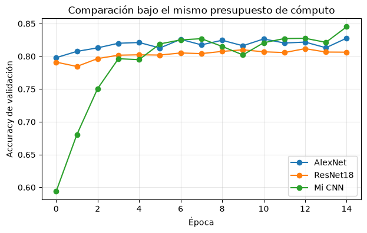
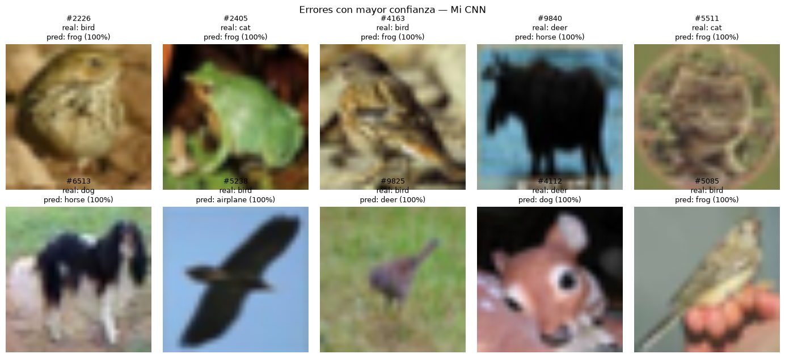

# MiCNN: a small CNN trained from scratch vs. ImageNet-pretrained classics on CIFAR-10

MiCNN is a custom convolutional neural network with **843,114 parameters**, trained from scratch on CIFAR-10. With the same training budget for every model, it beats AlexNet and ResNet18 used as frozen, ImageNet-pretrained feature extractors. It also trains in the least time of the three.

Built for the challenge *"Reto Relámpago: Derroten a las Clásicas"* in the AI Concentration at Tecnológico de Monterrey (Prof. Gerardo Ibarra Vázquez).

**Authors:** Bruno Arturo Goñi Flores · Manuel Antonio Perez Fonseca

---

## Results

| Model | How it's trained | Total params | Trainable params | Test accuracy | Training time |
|---|---|---|---|---|---|
| **MiCNN (ours)** | Entire network, from scratch | 843,114 | 843,114 | **83.5%** | **526 s** |
| AlexNet | Frozen ImageNet backbone + new linear head | 57,044,810 | 40,970 | 82.6% | 921 s |
| ResNet18 | Frozen ImageNet backbone + new linear head | 11,181,642 | 5,130 | 80.7% | 1,511 s |

**Same budget for all models:** 15 epochs or 30 minutes (whichever comes first), Adam, learning rate 0.001, batch size 64. All three models completed the 15 epochs. Trained on an Apple Silicon GPU (MPS).

> **Note on VGG16:** the challenge also included VGG16 as a baseline, but its run was interrupted in this notebook (see the `KeyboardInterrupt` in its cell), so it is not part of these results.



The pretrained baselines start high (≈80% after one epoch) and then plateau, because only their final layer can learn. MiCNN starts at 59%, catches up by epoch 6 and finishes highest at 84.5% validation accuracy.

### A fair caveat

The baselines train very few parameters: 41K for AlexNet and 5K for ResNet18, against all 843K in MiCNN. Measured as *accuracy per 100K trainable parameters*, the frozen baselines are far more efficient (ResNet18: 15.7, AlexNet: 2.0, MiCNN: 0.10). MiCNN wins on accuracy, total model size (13–68× smaller) and training time, not on how few weights it needs to update.

## The challenge

- Design a CNN with **fewer than 1 million trainable parameters**
- Train it **completely from scratch** (random initialization) on CIFAR-10
- Compare it against classic architectures pretrained on ImageNet, used as frozen feature extractors (only a new linear head is trained)
- The data pipeline and training function are a fixed protocol shared by every team, so the comparison is fair

## Architecture

```
Input 3×224×224 (CIFAR-10 upscaled to ImageNet size by the shared protocol)
 └─ AvgPool2d(7)            → 3×32×32     (0 params)
 └─ Conv block (3 → 32)     → 32×16×16
 └─ Conv block (32 → 64)    → 64×8×8
 └─ Conv block (64 → 128)   → 128×4×4
 └─ Conv block (128 → 192)  → 192×2×2
 └─ Global Average Pooling  → 192
 └─ Dropout (p = 0.4)
 └─ Linear (192 → 10)
```

Each conv block is `Conv 3×3 → BatchNorm → ReLU → Conv 3×3 → BatchNorm → ReLU → MaxPool 2×2`. The convolutions have no bias, because BatchNorm already adds its own shift.

### Design decisions

- **Undo the upscaling first.** The protocol resizes CIFAR-10 from 32×32 to 224×224 because the pretrained baselines expect that size. A 7×7 average pool brings the images back to 32×32, which recovers essentially the original image and makes each epoch about 49× cheaper, with zero parameters. AlexNet (stride 4) and ResNet (stride 2 + pooling) also shrink the input aggressively in their first layers.
- **Channels up, resolution down.** Channels grow 32 → 64 → 128 → 192 while the spatial size halves at each block, following the VGG convention. The last block stops at 192 instead of 256 to stay under the parameter limit.
- **Global Average Pooling instead of a large dense layer.** This turns each of the 192 feature maps into one number, so the classifier is a single 192 → 10 linear layer (1,930 parameters).
- **BatchNorm and Dropout** for faster, more stable training and regularization.

## Training setup

- CIFAR-10 from Hugging Face (`uoft-cs/cifar10`): 45,000 training / 5,000 validation (random 10% split, seed 42) / 10,000 test images
- Resized to 224×224 and normalized with ImageNet statistics (shared protocol for all models)
- No data augmentation, no learning-rate scheduler
- Adam, lr = 0.001, cross-entropy loss, batch size 64
- 15 epochs or 30 minutes, whichever comes first
- Test accuracy is measured on the model after its last epoch

## Error analysis

> The error-analysis cell was run on a separate MiCNN training run (1,793 errors, 82.1% test accuracy), so its counts differ slightly from the 83.5% in the results table.

The 10 test images MiCNN got wrong with the highest confidence:



- **Most frequent confusions:** dog ↔ cat (109 and 102 errors), bird → frog (102), cat → frog (80), dog → horse (73), bird → deer (72).
- **Weakest classes:** cat (64.5%), bird (67.2%) and dog (69.6%). **Strongest:** frog (93.1%), ship (92.4%) and automobile (90.2%).
- Many of the confident mistakes are small animals photographed against brown or green natural backgrounds. At 32×32, texture and background color seem to carry more weight than shape.

## Why it works

The pretrained backbones are frozen, so their ImageNet features are never adapted to small, blurry, upscaled CIFAR-10 images. Only their final layer learns. MiCNN is far smaller, but every one of its parameters is trained for this data. A large pretrained model isn't automatically the best tool, especially when it can't be fine-tuned.

## How to run

```bash
git clone https://github.com/<your-user>/micnn-cifar10.git
cd micnn-cifar10
python -m venv .venv
source .venv/bin/activate        # Windows: .venv\Scripts\activate
pip install -r requirements.txt
jupyter notebook micnn_vs_imagenet.ipynb
```

CIFAR-10 downloads automatically from Hugging Face the first time you run the notebook. A GPU is strongly recommended. The notebook uses CUDA or Apple Silicon (MPS) when available and falls back to CPU, which is much slower at 224×224.

## Repository structure

```
├── micnn_vs_imagenet.ipynb   # Full pipeline: data, baselines, MiCNN, comparison, error analysis
├── images/                   # Figures used in this README
├── requirements.txt
└── README.md
```
